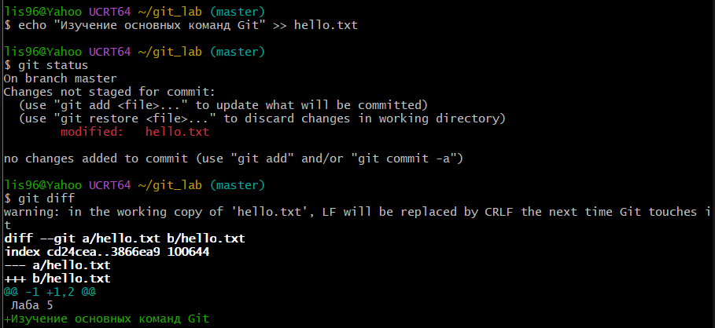
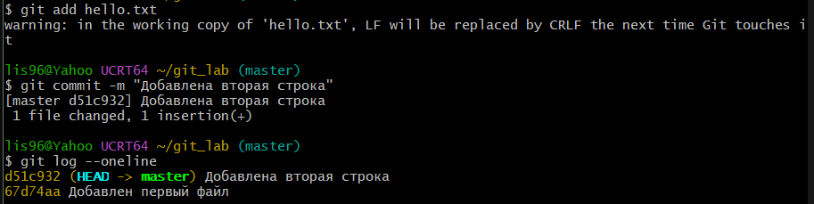
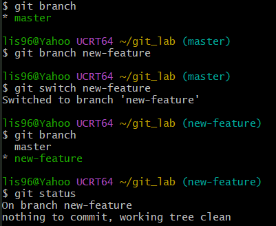
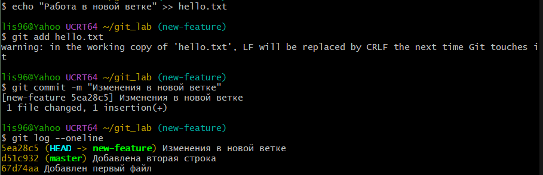
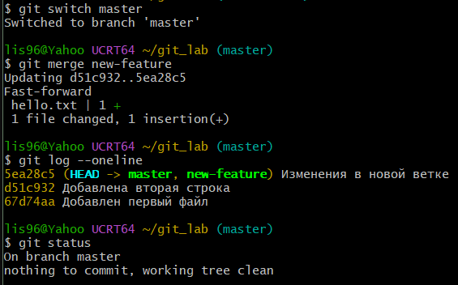
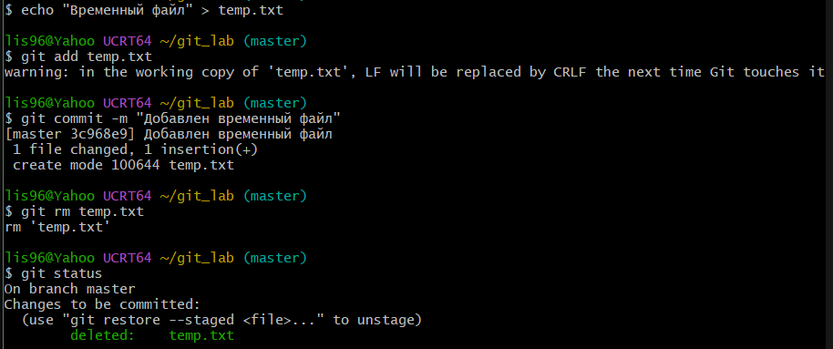
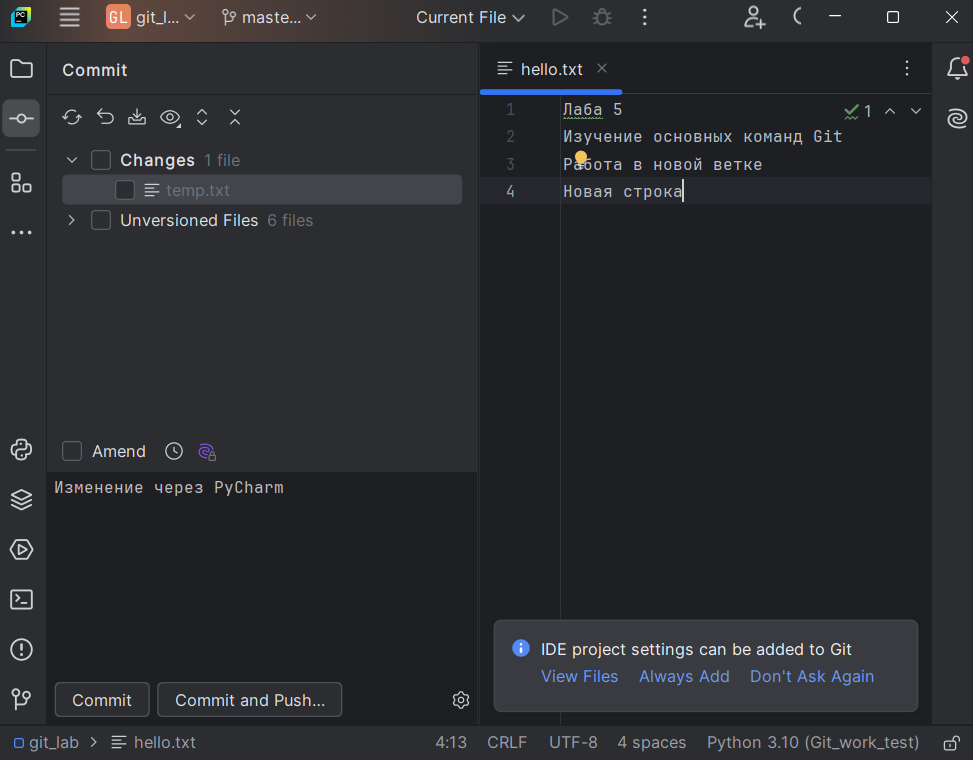

# Лабораторная работа №5. Работа с Git

**1. Настройка Git.**

- `git config --global user.name "..."` задаёт имя автора коммитов.
- `git config --global user.email "..."` задаёт почту автора.
- `git config --global --list` показывает сохранённые настройки.

**2. Создание локального репозитория.**

* `git init` создаёт репозиторий в папке git_lab.
* `git status` показывает состояние (No commits yet).
* `ls -a` показывает, что появилась скрытая папка .git.

**3. Первый файл и коммит.**

* `echo "..." > hello.txt` создаёт файл с текстом.
* `git status` показывает файл как Untracked.
* `git add hello.txt` добавляет файл в индекс.
* `git status` показывает файл в разделе Changes to be committed.
* `git commit -m "Добавлен первый файл"` сохраняет изменение.
* `git log --oneline` показывает историю.

**4. Просмотр изменений.**

* `echo "..." >> hello.txt` добавляет вторую строку в конец файла.
* `git status` показывает, что файл изменён.
* `git diff` показывает разницу между версиями (строка с +).

**5. Второй коммит.**

* `git add hello.txt`, затем `git commit -m "Добавлена вторая строка"`.
* `git log --oneline` показывает два коммита.

**6. Создание и переключение между ветками.**

* `git branch` показывает список веток (только master).
* `git branch new-feature` создаёт ветку.
* `git switch new-feature` переключает на неё.
* `git branch` показывает звёздочку у new-feature.
* `git status` показывает, что текущая ветка new-feature.

**7. Изменения в новой ветке.**

* `echo "..." >> hello.txt`, `git add hello.txt`, `git commit -m "Изменения в новой ветке"`.
* `git log --oneline` показывает три коммита, HEAD на new-feature, master отстаёт.

**8. Объединение веток с помощью git merge.**

* `git switch master` возвращает в основную ветку.
* `git merge new-feature` переносит изменения (Fast-forward).
* `git log --oneline` показывает три коммита уже в master.
* `git status` показывает, что рабочая папка чистая.

**9. Удаление файла с помощью git rm.**

* `echo "Временный файл" > temp.txt` создаёт файл.
* `git add temp.txt` и `git commit -m "Добавлен временный файл"` сохраняют его.
* `git rm temp.txt` удаляет файл через Git.
* `git status` показывает deleted: temp.txt в Changes to be committed.

**10. Открытие проекта и изменение файла.**

* File → Open: `git_lab`.
* В файл `hello.txt` добавляется новая строка и коммитится.

**11. Загрузка проекта на GitHub.**

* `git remote add origin <ссылка на репозиторий в GitHub>` привязывает уже существующую локальную папку к удаленному репозиторию.
* `git push` загрузка всех изменений.

**Вывод.**

В ходе работы выполнены создание репозитория, сохранение изменений, работа с ветками и объединение веток, удаление файла через Git, а также коммит и загрузка проекта на GitHub через PyCharm. 
